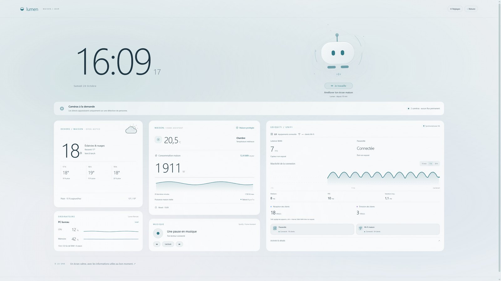
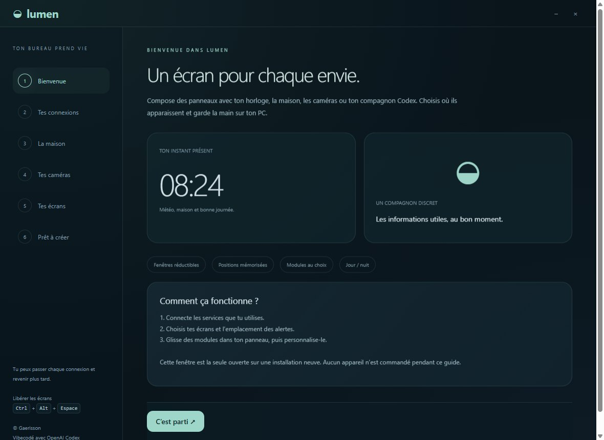
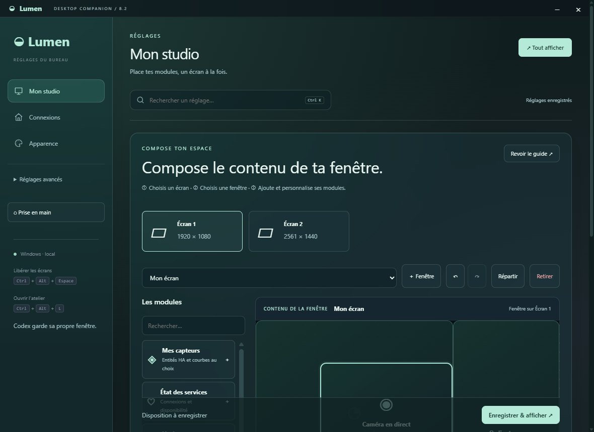
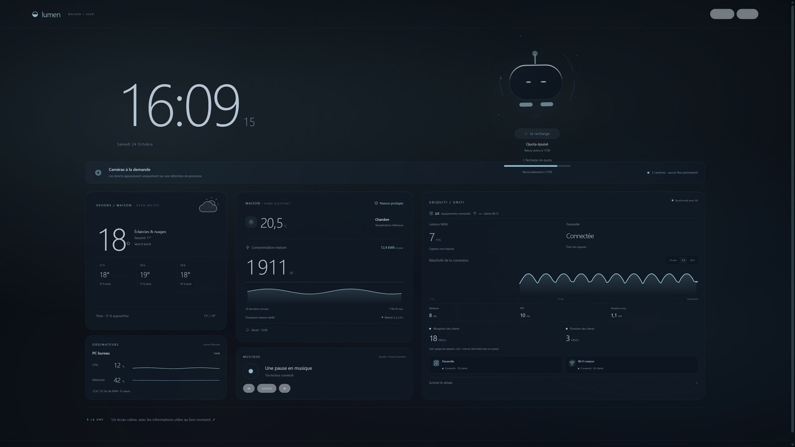
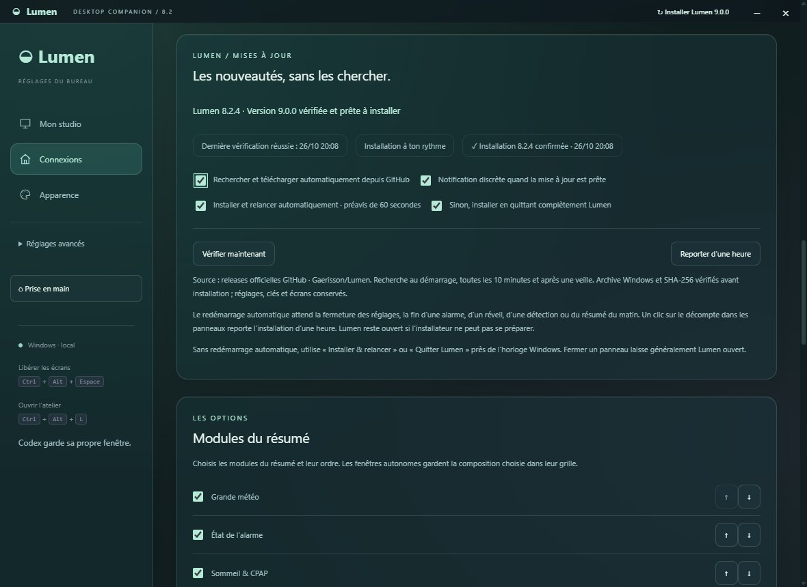
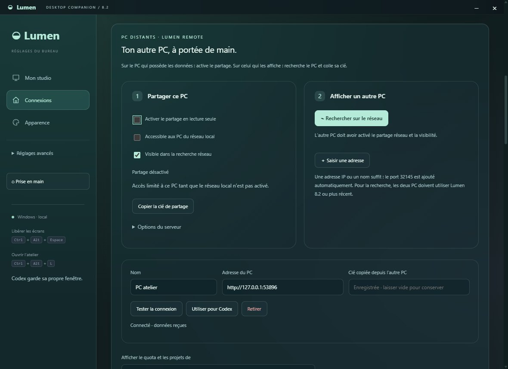
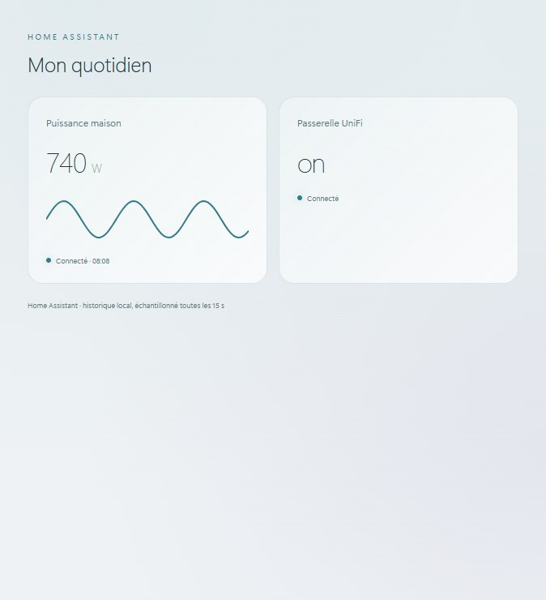
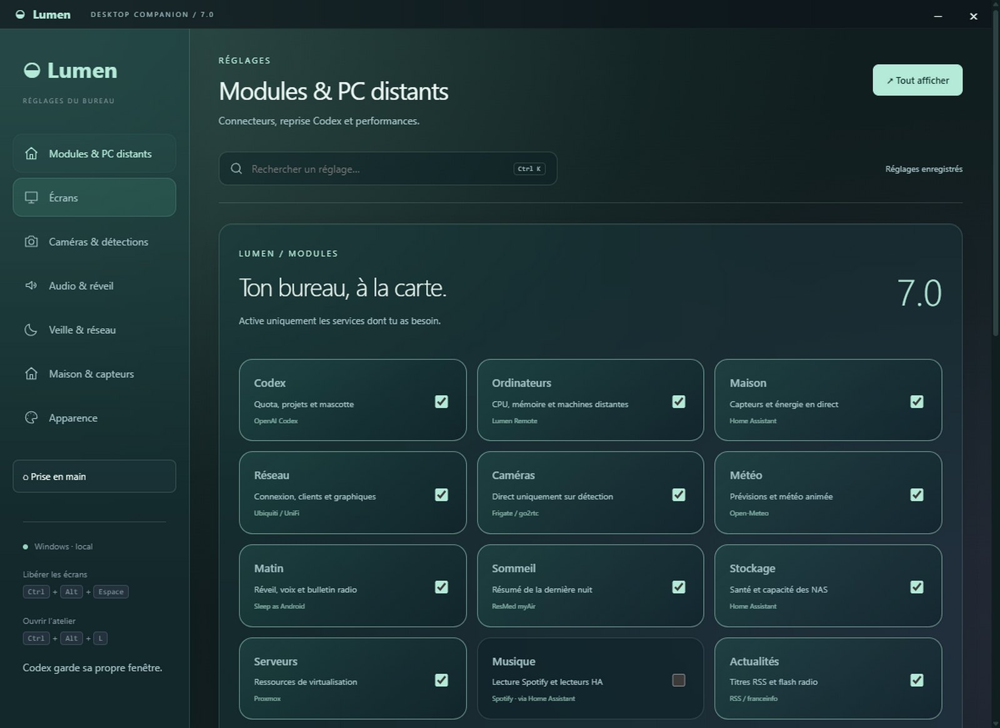

<div align="center">

# ◒ Lumen

### Un bureau Windows qui vit au rythme de ta maison.

Horloge, mascotte Codex, maison connectée et ordinateurs distants — à la carte, sur plusieurs écrans.

    [](https://github.com/Gaerisson/Lumen/actions/workflows/ci.yml)

**© 2026 Gaerisson · Vibecodé avec OpenAI Codex**



</div>

Lumen compose un bureau multi-écrans sans remplacer l’app Codex. Chaque fenêtre peut rester au premier plan, se réduire, passer en plein écran ou accueillir plusieurs éléments. Les positions sont mémorisées. Un raccourci libère immédiatement les écrans.

## Prise en main

Au premier lancement, **une seule fenêtre de bienvenue** : connecte les services utiles, choisis tes capteurs dans les listes Home Assistant, puis l’écran de chaque alerte. Le **studio visuel** permet d’ajouter, déplacer et redimensionner les modules à la souris, écran par écran. Les installations existantes conservent leurs panneaux.





[Le guide de configuration](docs/setup.md) détaille les étapes, Frigate en direct, les alertes et les mises à jour. Les réglages avancés restent repliés pour garder une navigation simple. À 100 % de capacité Codex restante, aucun décompte n’est affiché ; à quota épuisé, le temps de recharge reste visible.

## Un écran utile, même au repos

| Maison & quotidien | Codex & ordinateurs |
| --- | --- |
| Horloge, météo et prévisions horaires | Quota session/semaine, crédits exposés par Codex |
| Puissance électrique avec source et fraîcheur | Mascotte active, au repos ou en recharge après quota |
| Sécurité, chambre et réveil | Projet courant, durée observée et commandes masquées des secrets connus |
| Personnes détectées : caméra à la demande | Graphiques CPU et RAM locaux ou distants |
| Réseau UniFi, NAS et Proxmox via HA | Partage distant authentifié, en lecture seule |
| Résumé du matin, voix et bulletin radio optionnels | Veille dans les fenêtres existantes, sans doublons |
| Spotify direct : appareils, volume et lecture | Modules indépendants et recherche de réglages |



## Correctif 8.2.5

Le contrôle PowerShell accepte les démarrages lents sous charge : jusqu’à 20 secondes, avec vérification du moteur avant installation.

## Mises à jour 8.2.4

Installation depuis les releases GitHub, avec une option de redémarrage automatique : préavis de 60 secondes, report d’une heure et pause pendant les réglages ou les alertes. Lumen attend que l’installateur ait validé et extrait l’archive avant de quitter. La version réellement exécutée confirme ensuite l’installation. [Fonctionnement](docs/setup.md#mises-à-jour-automatiques).

## Correctif 8.2.3

Les fenêtres retrouvent leur moniteur après un changement d’identifiant Windows. Un écran détecté tardivement ou temporairement débranché ne remplace plus la préférence sauvegardée. La restauration conserve les fenêtres existantes et corrige le placement après le plein écran. [Détails](docs/setup.md#composer-plus-facilement).

## Correctif 8.2.2

La copie de la clé de partage et de l’adresse Spotify utilise le presse-papiers natif Windows. Elle fonctionne même lorsque le navigateur refuse la permission Clipboard, et ne renouvelle pas une clé existante.

## Correctif 8.2.1

Les mises à jour sont recherchées toutes les 10 minutes, réessayées après une panne réseau et signalées par une notification silencieuse et une pastille. Le suivi indique les dernières et prochaines vérifications. Le moteur Windows est vérifié avant installation, avec prise en charge de PowerShell 7. [Détails](docs/setup.md#mises-à-jour-automatiques).



## Nouveautés 8.2

- **PC distants** : recherche automatique sur le réseau, test de connexion, adresses simplifiées et clé copiée sans casser les clients existants. [Jumeler deux PC](docs/remote.md).
- **Studio plus clair** : écran → fenêtre → modules, cadre du contenu et proportions réelles de la fenêtre.
- **Proxmox personnalisable** : VM, CT, nœuds ou sauvegardes ; métriques et entités choisies pour chaque carte.
- **Options par carte** : titre, densité, PC à afficher, entités NAS et nombre de titres d’actualité.



## Nouveautés 8.1

- **Mes capteurs** : choisis tes entités Home Assistant, leurs valeurs et leurs courbes locales.
- **État des services** : vois les connexions disponibles, à configurer ou désactivées.
- **Studio** : annuler/rétablir, répartir les cartes, déplacer un panneau entre écrans. Les sauvegardes conservent les fenêtres inchangées et la connexion HA.
- **Mises à jour** : téléchargements regroupés et récupération après échec ou archive manquante.




[Historique des versions](docs/changelog.md)

## Modules & connecteurs

Active uniquement ce qui t’intéresse dans **Modules & PC distants**. Les connexions sont facultatives. Aucun serveur personnel, clé ou compte n’est fourni avec le projet.

- **Home Assistant** : API et flux WebSocket, recherche d’entités par nom, identifiant et unité. Les correspondances connues sont proposées et restent modifiables. Une mesure en VA n’est jamais présentée comme une puissance active en W.
- **Frigate / go2rtc** : détection de personnes, vidéo seulement lorsqu’elle est utile, restitution du format de la caméra, audio et bips configurables. Les flux masqués sont déchargés.
- **OpenAI Codex** : lecture du quota local par App Server, avec secours par les journaux locaux. Un PC distant peut fournir ces données sans partager son compte.
- **Lumen Remote** : CPU/RAM, quota et, en option, titres de projets. Les commandes, brouillons, clés HA et identifiants Codex ne traversent pas ce protocole.
- **Spotify Web API** : connexion guidée OAuth PKCE, pochette, titre, artiste, appareil, lecture/pause, précédent/suivant et volume. Les jetons sont chiffrés par Windows. La lecture s’effectue sur un appareil Spotify existant ; Lumen ne fournit pas de moteur de streaming.
- **Ubiquiti / UniFi, NAS et Proxmox** : capteurs exposés par Home Assistant ; les mesures indisponibles restent signalées comme telles.
- **Sleep as Android / ResMed myAir** : entités Home Assistant configurables, résumé de la dernière nuit et routines de réveil. La disponibilité dépend de ces intégrations.
- **Open-Meteo, RSS, NRJ, RFI, franceinfo** : météo, titres et bulletin radio facultatif. La voix Windows fonctionne localement ; Mistral nécessite sa propre clé et peut facturer les lectures.
- **Twinkle Tray** : réglage de luminosité sur les écrans compatibles, si activé et installé séparément.



## Installer sur un autre PC

Télécharge l’archive Windows d’une version, extrais-la dans un dossier accessible en écriture, puis lance `Lumen.exe`. Il n’y a pas d’installateur système ni de droits administrateur nécessaires à l’app elle-même. Les paramètres et clés sont créés localement dans `data/`.

**Ne copie pas le dossier `data/` de ton PC principal.** Les secrets sont chiffrés pour le profil Windows d’origine. Connecte chaque PC et jumelle-les dans les options si nécessaire.

Les mises à jour stables sont téléchargées depuis GitHub, vérifiées par SHA-256 puis installées à la fermeture si l’option est activée. Le dossier `data/` reste préservé. Les options de téléchargement et d’installation sont indépendantes, dans **Connexions**. Le binaire Windows est actuellement non signé ; le SHA-256 ne remplace pas une signature de code.

### Quota et capteurs distants

1. Sur le PC qui héberge Codex, ouvre **Modules & PC distants** et génère une clé de jumelage.
2. Active le partage. Pour un autre PC, active aussi l’accès au réseau local et autorise uniquement les machines de confiance dans le pare-feu Windows.
3. Sur le PC client, ajoute l’adresse du PC hôte et sa clé. Choisis-le comme source du quota.
4. Ajoute d’autres PC de la même manière pour leurs capteurs CPU/RAM.

Le serveur écoute uniquement sur `127.0.0.1` par défaut ; le réseau local nécessite une option explicite. Le port par défaut est `32145`. Sur un réseau non fiable, utilise un VPN privé ou un reverse proxy HTTPS. Le protocole HTTP seul ne chiffre pas le transport. Aucun port du pare-feu n’est ouvert par Lumen.

Un **agent sans interface** fournit seulement les capteurs d’un PC équipé de Node.js :

```powershell
node src/agent.cjs --token-file C:\Private\lumen-pair.key --host 127.0.0.1 --port 32145
```

Depuis les sources, utilise la commande ci-dessus. Dans les nouveaux builds Windows, le point d’entrée est `resources/app/src/agent.cjs` ; l’archive 7.1.0 déjà publiée utilise encore `resources/app/agent.cjs`. Node.js reste nécessaire.

Crée un secret aléatoire d’au moins 32 caractères dans ce fichier privé. Pour le réseau local, choisis explicitement une adresse d’écoute adaptée. Les arguments du processus ne contiennent pas la clé.

### Connexion Spotify guidée

1. Active **Spotify** dans les modules et ouvre son assistant.
2. Crée une application dans le [tableau de bord Spotify Developer](https://developer.spotify.com/dashboard), avec l’API Web.
3. Enregistre exactement cette Redirect URI : **http://127.0.0.1:32146/callback**.
4. Copie le **Client ID public**, puis clique sur **Enregistrer et connecter Spotify**. Ne saisis jamais de Client Secret.
5. Autorise l’accès sur Spotify, puis vérifie la connexion dans Lumen. Ouvre Spotify sur un de tes appareils pour le voir apparaître.

Le contrôle requiert Premium. Les applications en mode développement restent soumises aux [limites Spotify](https://developer.spotify.com/documentation/web-api/tutorials/february-2026-migration-guide), notamment les utilisateurs autorisés. Lumen n’est pas une application Spotify approuvée pour une distribution étendue. [Documentation PKCE](https://developer.spotify.com/documentation/web-api/tutorials/code-pkce-flow).

### Flash audio et préécoute

Dans **Audio & réveil**, choisis NRJ, RFI, franceinfo ou un podcast RSS personnel. Le dernier bulletin récent est sélectionné, avec volume, vitesse et durée maximale réglables. Les publicités éventuelles dépendent des radios. **Flash local** lit les titres RSS avec la voix Windows, sans publicité ajoutée par Lumen. Les aperçus sont limités à 20 secondes et possèdent un bouton d’arrêt. La voix Mistral exige une action explicite avant un aperçu facturable.

Lumen affiche l’activité Codex en lecture seule. La reprise automatique des chats a été retirée : aucun message de reprise n’est envoyé.

## Performances & contrôle

- Mode économe par défaut : fond statique, petites animations conservées.
- Écrans masqués : minuteries et animations suspendues. La veille réutilise les fenêtres existantes et restaure leurs positions.
- Caméras inutilisées : document vidéo déchargé, connexions et décodage arrêtés.
- Événements HA regroupés ; historiques et nœuds DOM réutilisés.
- Graphiques stables entre deux mesures, valeurs numériques alignées.
- Thèmes noir/blanc automatiques selon lumière et soleil, avec horaires de secours.
- Réduction des animations système respectée.

**Ctrl + Alt + Espace** libère les écrans. **Ctrl + Alt + L** ouvre les réglages. Les fenêtres restent réductibles ; Lumen ne verrouille pas le bureau.

## Développer

Pré-requis : Windows, Node.js 24 et npm. Dépendances verrouillées dans `package-lock.json`.

```powershell
npm ci
npm test
npm start
```

Pour isoler le profil de développement : définis `LUMEN_DATA_DIR` vers un dossier privé. Pour produire une version portable :

```powershell
npm run build
```

Sortie : `dist/Lumen/`. `LUMEN_OUTPUT` permet de choisir une autre destination ; `npm run build -- --update` met à jour un dossier existant après fermeture de Lumen. Les profils utilisateurs ne doivent jamais être ajoutés à une archive de distribution.

Validation native, avec profils et services simulés :

```powershell
npm run smoke
npm run smoke:home
npm run smoke:performance
```

Les tests ne déclenchent aucune vraie alarme et ne règlent pas la luminosité matérielle. Le protocole remote est testé sur la boucle locale ; une seconde machine physique n’a pas encore servi à la validation.

## Organisation du projet

```text
Lumen/
├── src/
│   ├── main/          # Processus Electron, services et connecteurs
│   ├── renderer/      # Pages, scripts d’interface et styles
│   ├── shared/        # Calculs et règles partagés
│   └── agent.cjs      # Agent de capteurs distant
├── assets/icons/      # Icônes de l’application
├── tests/
│   ├── unit/          # Tests unitaires
│   └── smoke/         # Vérifications natives Windows
├── scripts/           # Compilation et contrôle de structure
├── docs/              # Installation, développement, crédits et captures
└── .github/workflows/ # Validation automatique
```

Les profils locaux et résultats de tests restent exclus du dépôt. Pour commencer : [installation](docs/installation.md), [développement](docs/development.md), [sécurité](SECURITY.md), [crédits des services](docs/third-party-notices.md).

Lumen est un projet indépendant de Gaerisson, vibecodé avec OpenAI Codex. Les noms et marques des connecteurs appartiennent à leurs propriétaires respectifs. Aucune affiliation officielle n’est revendiquée. © 2026 Gaerisson. Tous droits réservés sur le code original ; voir [LICENSE](LICENSE).
